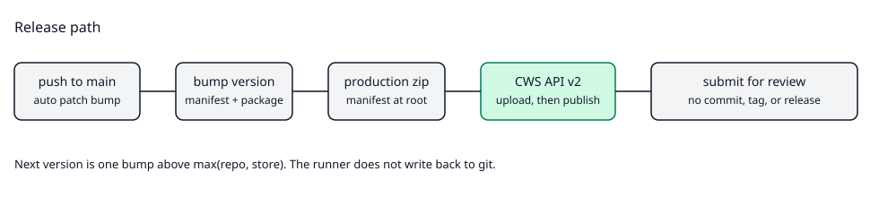
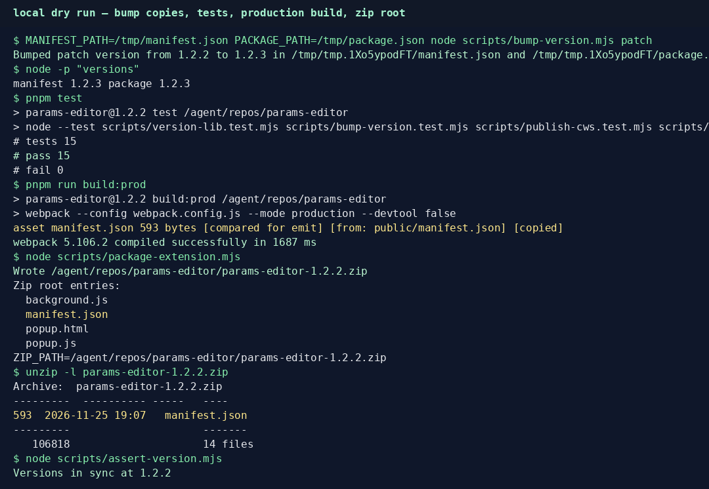

# CI/CD

Live Crit review: https://crit.md/r/u_BF-5aBybDrHgkadtwJ8

Chrome Web Store deploys for Params Editor. Nothing in this pipeline changes extension behavior. It typechecks, tests, builds, bumps the version, and uploads the zip.



## Architecture

| Piece | Role |
| --- | --- |
| [`.github/workflows/ci.yml`](../.github/workflows/ci.yml) | On every pull request and every push to `main`: install, typecheck, test, production build. Read-only token. |
| [`.github/workflows/release.yml`](../.github/workflows/release.yml) | On every push to `main`: patch-bump, build, upload, and submit for review. Manual dispatch remains for minor, major, upload-only, and dry run. |
| [`scripts/bump-version.mjs`](../scripts/bump-version.mjs) | Writes the next version into both version files in the working tree. The release job does not commit that write. |
| [`scripts/resolve-deploy-version.mjs`](../scripts/resolve-deploy-version.mjs) | Reads the store item and sets the runner version to one bump above `max(repo, store)`. |
| [`scripts/assert-version.mjs`](../scripts/assert-version.mjs) | Fails if the two version fields differ, or if the new version is not strictly greater. |
| [`scripts/package-extension.mjs`](../scripts/package-extension.mjs) | Zips `dist/` so `manifest.json` is at the archive root. |
| [`scripts/publish-cws.mjs`](../scripts/publish-cws.mjs) | Service-account JWT, then Chrome Web Store API **v2**. |
| `pnpm run build:prod` | `webpack --mode production --devtool false`. `pnpm run build` is still the development build. |

There is no third-party Chrome Web Store action. Upload is the small Node script above. `pnpm/action-setup@v4` only installs pnpm so `actions/setup-node` can cache the lockfile. `actions/upload-artifact@v4` keeps the zip on the workflow run.

API choice: Chrome Web Store API v2 (`chromewebstore.googleapis.com`). Google turned the v1.1 API off on 15 October 2026. v2 needs the publisher id in the path. Each run signs a short-lived JWT with the service account key and exchanges it for an access token. There is no stored refresh token.

The store API cannot create the first listing. Upload the first package in the [developer dashboard](https://chrome.google.com/webstore/devconsole), including the store listing and privacy tabs, before this workflow can update it.

**Merging this change is a push to `main`.** That push reads the live store version, patch-bumps above it in the runner, uploads, and submits the item for review. The three repository secrets are already set. Nothing is committed back. Do not merge until that first automatic release is intended.

## What a push to main does

A normal release is a push to `main`. Nobody runs the workflow by hand. The workflow does not push commits, tags, or GitHub Releases. Its token is read-only, so a deploy cannot start another deploy.

1. It typechecks and tests.
2. It calls `fetchStatus` on the Chrome Web Store item. If that call fails, or a returned version is malformed, the run stops. It does not invent a version.
3. The next version is one bump above `max(repo version, highest store version)`. A push uses `patch`. The highest store version is the greater of the published package and any submitted package. If the item has neither, the repo version is the floor.
4. That version is written to `package.json` and `public/manifest.json` in the runner only. The repository stays at its committed version.
5. It production-builds and zips `dist/`.
6. It uploads the zip, then calls `:publish` with `DEFAULT_PUBLISH`. That submits the item for review. It goes live after Google approves it. Review is not skipped.

`ci.yml` still runs on pull requests and on pushes to `main`. Release repeats typecheck, test, and the production build before it uploads. Both running on `main` is expected.

Pushes share the concurrency group `chrome-web-store-release` with `cancel-in-progress: false`, so a second push waits. Each push asks the store for the current version, so a queued run bumps above whatever the previous upload already submitted.

### Skip a deploy

GitHub does not start `push` or `pull_request` workflows when the head commit message contains any of `[skip ci]`, `[ci skip]`, `[no ci]`, `[skip actions]`, or `[actions skip]`. That includes this Release workflow's `push` trigger and `ci.yml`. It does not apply to **Run workflow**.

### Minor, major, upload-only, dry run

Actions → **Release** → **Run workflow** on `main`.

- `minor` or `major` applies that bump to `max(repo, store)`. A push always uses `patch`.
- `upload-only` uploads and does not call `:publish`.
- Dry run checks the three secrets and, when they are usable, reads the store and prints the version it would upload. It still builds the zip. It does not upload. Missing secrets fail with their names, and the log says the next version was not computed.

## Version rules

- The committed version in `package.json` and `public/manifest.json` is a floor. It is not the version that gets uploaded.
- Deploy version = bump(`max(repo, store)`), where store is the highest `crxVersion` on the published or submitted package.
- Compare segments as integers. `1.10.0` is greater than `1.9.0`.
- Both files must already match before the run. The bump script refuses a mismatch.
- Webpack copies the runner's `public/manifest.json` into `dist/manifest.json`. Resolve the version, then `pnpm run build:prod`, then zip.
- The zip name is `params-editor-<version>.zip`.
- `pnpm run bump:version` only edits your checkout. It does not change what the next deploy uploads unless that edit is committed and is higher than the store.

`pnpm run build` is not the store build. It stays `mode: development` with inline source maps, which is the previous local behavior.

## Secrets Utsav needs before the first release

Add these as **repository** secrets. Not in git, not in the workflow file.

GitHub → **Settings** → **Secrets and variables** → **Actions** → **New repository secret**.

| Secret | What it is |
| --- | --- |
| `CHROME_EXTENSION_ID` | 32-character item id, letters `a`–`p` only. |
| `CHROME_PUBLISHER_ID` | Publisher id from the developer dashboard. Required by API v2. |
| `CHROME_SERVICE_ACCOUNT_JSON` | Full contents of the service account JSON key file. Not a path and not base64. |

The workflow only reads the repository. It does not need permission to push.

No other secrets are required. Do not add an access token. Each release mints one from the service account key and drops it when the job ends. The key keeps working until you delete it in IAM. There is no consent screen.

### 1. Google account

Use the Google account that owns the Chrome Web Store item. Turn on 2-step verification. The store requires it before you can publish.

### 2. Google Cloud project and the API

1. Open [Google Cloud Console](https://console.cloud.google.com/).
2. Create a project, or select one. A dedicated project such as `params-editor-cws` is easier to reason about.
3. APIs & Services → Library. Search **Chrome Web Store API**.
4. Enable **Chrome Web Store API**.

### 3. Service account and JSON key → `CHROME_SERVICE_ACCOUNT_JSON`

1. IAM & Admin → Service accounts → **Create service account**.
2. Name it `params-editor-release`. No roles are required. Skip the optional permission steps and create it.
3. Open that service account → **Keys** → **Add key** → **Create new key** → **JSON** → Create. The browser downloads a key file.
4. Open the [developer dashboard](https://chrome.google.com/webstore/devconsole) → **Account**. Add the service account email (`…@….iam.gserviceaccount.com`). A publisher can have one service account.
5. Open the downloaded JSON file and copy its **entire contents** into the `CHROME_SERVICE_ACCOUNT_JSON` repository secret. Paste the JSON itself. Do not paste a file path, and do not base64-encode it.

The workflow passes that secret to `scripts/publish-cws.mjs` as an environment variable. The script parses it in memory, signs a JWT with `client_email` and `private_key`, and exchanges the JWT at `token_uri` (usually `https://oauth2.googleapis.com/token`). It does not write the key to disk and does not print it. Scope is `https://www.googleapis.com/auth/chromewebstore`.

### 4. Extension id → `CHROME_EXTENSION_ID`

Either:

- `chrome://extensions` with Developer mode on. Copy the **ID** under Params Editor. It is 32 characters from `a` to `p`.
- Or the [developer dashboard](https://chrome.google.com/webstore/devconsole) → the item → **Package**. The item id is the same value.

The unpacked local id and the published id match only when the extension is loaded with the store's key. Use the id shown on the published item, not a random unpacked load.

### 5. Publisher id → `CHROME_PUBLISHER_ID`

1. Open the [developer dashboard](https://chrome.google.com/webstore/devconsole).
2. If the account belongs to more than one publisher, switch to the publisher that owns Params Editor.
3. **Publisher** → **Settings** (account settings).
4. Copy the **Publisher ID** shown there.

That id is not the extension id. v2 returns a confusing 404 when they are swapped.

## Optional upload-only check

Normal pushes submit for review. To upload without submitting, use **Run workflow** with publish target `upload-only`. That does not commit anything. A dry run does not upload.

`DEFAULT_PUBLISH` submits the item for review and, after Google approves it, publishes to the audience already configured on the item. It does not skip review. The API keeps the current visibility. If you changed visibility in the dashboard, Google requires one manual publish with the new visibility before the API will publish again.

## Rollback

You cannot republish an older version number. The store version only moves forward.

- Still in review, not yet published: dashboard, or `POST https://chromewebstore.googleapis.com/v2/publishers/PUBLISHER_ID/items/EXTENSION_ID:cancelSubmission` with the same Bearer token. This workflow does not call that.
- Already published: `POST https://chromewebstore.googleapis.com/v2/publishers/PUBLISHER_ID/items/EXTENSION_ID:rollback` with JSON `targetCrxVersion` (the older published package), `newVersion` (strictly greater than the package that is live now), and `rollbackReason`. `validateOnly: true` checks the call without rolling back. The old package is published again under the new version number.
- Code fix: push the fix to `main`. That push reads the store version, patch-bumps above it, and submits a new build.

## Local check

```bash
pnpm install --frozen-lockfile
pnpm run typecheck
pnpm test
node scripts/bump-version.mjs patch   # writes both version files; git checkout -- them if you were only proving the script
pnpm run build:prod
node scripts/package-extension.mjs
unzip -l params-editor-*.zip
```

`manifest.json` in that listing must not be nested under `dist/`. A local secret check with empty env:

```bash
node scripts/publish-cws.mjs --dry-run
```

That exits 1 and prints the three secret names. It does not call Google.

## Troubleshooting

| What you see | What to do |
| --- | --- |
| `Missing GitHub Actions secrets` and a list of names | Add those repository secrets. Names must match exactly. Environment secrets are invisible to this workflow because it does not set `environment:`. |
| `CHROME_EXTENSION_ID must be the 32-character...` | The value has the wrong length or a character outside `a`–`p`. The log does not print the value. |
| `CHROME_SERVICE_ACCOUNT_JSON is not valid JSON` or `missing private_key` | The secret is not the full key file. Paste the JSON object, including `type`, `client_email`, and `private_key`. The log does not print the value. |
| `Service account token exchange failed` | The key was deleted or disabled in IAM, or the service account email is not added under Developer Dashboard → Account. Create a new JSON key only if the old one is gone. A valid key does not expire on its own. |
| `Could not read the current store item` / 404 | Publisher id and extension id are swapped, the service account is not linked to that publisher, or the first listing was never created in the dashboard. |
| `versions must strictly increase` before upload | The manifest was not bumped past the version already published or submitted. Dispatch again with a bump, or remove the stuck submission. |
| `Next version was not computed` | The store lookup failed or the secrets are missing. The run did not invent a version. Fix the named secrets or the item id, then rerun. |
| Store error that mentions version, during upload | The package was not above the published or submitted version. The next run reads the store again. |
| Upload succeeded, publish failed | That version is already on the item. The next push reads it and chooses a higher one. You can also publish the draft from the dashboard. Check whether visibility was changed and needs one manual publish. |
| `Run this workflow from the main branch` | The dispatch ref was not `main`. Re-run and select `main`. |
| A push to `main` did not deploy | The commit message contains `[skip ci]`, `[ci skip]`, `[no ci]`, `[skip actions]`, or `[actions skip]`. GitHub does not start the push trigger for those strings. |
| Zip rejected for layout | `manifest.json` must be at the root of the zip. `scripts/package-extension.mjs` builds that layout from `dist/`. Do not zip the `dist` folder itself. |


