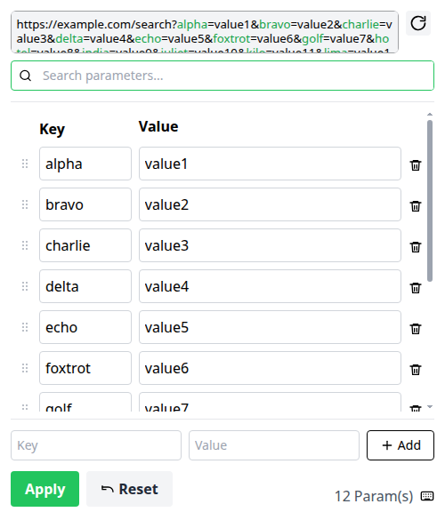
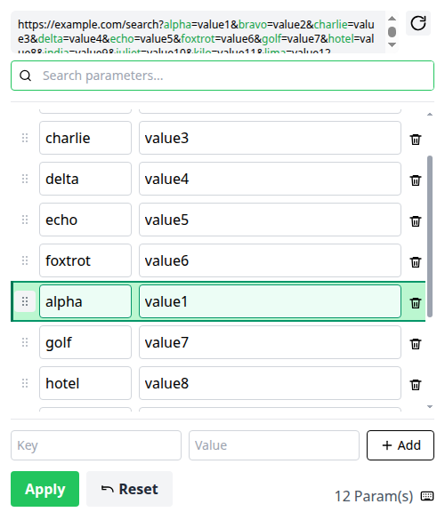
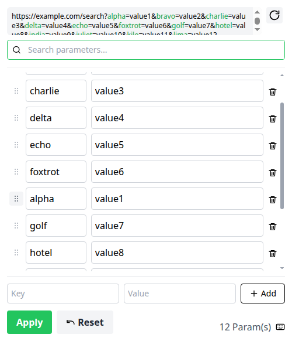

# Drag-to-reorder query params

Live review: https://crit.md/r/oYOU4CMtQKW9dwsIxwQ8P

## What changed and why

The popup could edit, add, delete, filter, reset, and apply query params, but not change their order. Apply already walked `currentParams` from top to bottom, so a reorder only had to change that array.

The grip sits inside the key cell, to the left of the key input. The table stays three columns wide, which keeps the 500px popup from growing sideways. Only that grip starts a drag. Key and value inputs are unchanged: typing, Enter-to-apply, and the other shortcuts still go to the inputs.

No new dependency, service, or secret. Dragging uses pointer events. Auto-scroll uses `requestAnimationFrame`. Order math lives in `src/param-reorder.ts` and is covered by `node:test` (`pnpm test`).

## Drag and auto-scroll

- Pointer down on `.param-drag-handle` starts the drag. The row gets `is-dragging` (green fill, green input borders, left bar). `body` gets `params-dragging` so the cursor stays a grab.
- The row moves when the pointer crosses the midpoint of a neighbor. That avoids the row oscillating around the cursor.
- `#paramsScroll` is the list scroller (`max-height: 340px`). Header, search, and Apply/Reset stay put.
- While the pointer is within 36px of the top or bottom of that scroller, the list scrolls up to 18px per frame, and only if there are more rows in that direction. Both directions use `autoScrollStep`.
- On pointer up, the DOM order is written back into `currentParams` and the list re-renders. A drop that does not move the row leaves the array alone.

## Search filter

Dragging is disabled while the search box is not empty (`canReorderList`).

The filtered table is a subset. A drop among the visible rows does not have one safe index for the hidden rows, so the handles stay on screen but are inert (`aria-disabled`, tooltip "Clear search to reorder"). Filtering does not change array order. Clearing the search turns dragging back on.

## Apply order

Apply calls `buildSearch(currentParams)` and sets that string as the URL search.

- Blank keys are skipped, same as before.
- Lists of 100 rows or fewer go through `URLSearchParams.append` in array order (spaces encoded as `+`).
- Longer lists use `encodeURIComponent` in array order (spaces as `%20`), matching the old branch, which keyed off the full row count including blanks.
- The background script parses the URL again with `URLSearchParams`. That keeps insertion order, so the tab URL matches the list.

Reset before Apply restores the last loaded or applied order. Reset after a successful Apply keeps the order that was just written, because `originalParams` is updated on success.

The URL bar at the top still shows the last applied URL until Apply. A reorder alone does not change it.

## How to test manually

1. `pnpm install && pnpm test && pnpm run build`
2. Load `dist/` as an unpacked extension.
3. Open a tab whose URL has 8 or more query params, then open the popup.
4. Drag a row by the grip, including a drag that starts near the top and a drag that starts near the bottom, so the list scrolls both ways. Confirm the green row is the landing spot.
5. Click Apply and confirm the address bar uses the new order. Values must stay with their keys.
6. Reorder again and click Reset before Apply. The previous order comes back.
7. Type in a key and a value, add a row, delete a row. Those still work.
8. Type in Search. The grips do not drag. Clear the search and drag again. The footer count still shows `filtered/total` while searching.

Headless capture of this UI (real `dist/popup.js`, Chrome DevTools pointer events, `chrome.runtime` stubbed with a 12-param URL):

`node scripts/capture-reorder-screenshots.mjs`

That run checked: downward auto-scroll (`scrollTop` 0 → 75 while `alpha` moved under `foxtrot`), Apply URL `bravo, charlie, delta, echo, foxtrot, alpha, golf, hotel, india, juliet, kilo, lima` with `alpha=value1`, Reset-before-Apply restoring `alpha` first, Reset-after-Apply keeping the applied order, upward auto-scroll (`scrollTop` 250 → 232 while dragging `lima`), typing updating the model, and a search for `juliet` leaving the only visible grip disabled.

## Screenshots

Captured from the built popup, not mockups. The mid-drag frame is a real held pointer (`is-dragging` still set) taken before mouseup.

`docs/screenshots/01-drag-handles.png` — 12 params, grip on the left of each key, scrollbar on the list.

`docs/screenshots/02-mid-drag.png` — `alpha` held between `foxtrot` and `golf`. The list has scrolled (`scrollTop` 75); `charlie` is the first visible row. Green row is the landing spot.

`docs/screenshots/03-after-reorder.png` — same order after release, highlight cleared, list still scrolled. The URL bar is still the pre-Apply URL.

## Layout note

The add row's flex item could not shrink below the inputs' minimum content size, so "+ Add" was clipped inside the 500px popup. The row and its inputs now use `min-w-0`, and the button fits. Editing, adding, and applying are otherwise the same.
